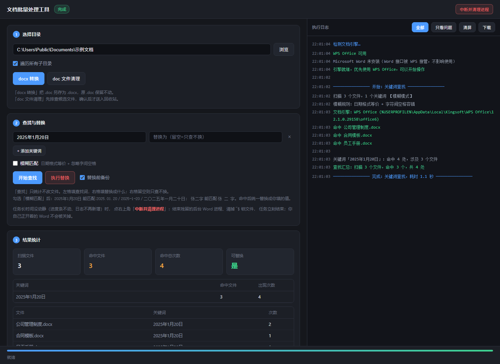

# 文档批量处理工具 · Word Doc Toolkit

> **Word 文档批量处理工具** —— doc 转 docx、批量替换关键词、批量查找、文件清理。在本地运行，不上传、不联网，原文件格式不走样。

一个面向 Windows 的桌面小工具：跑在本地浏览器里，底层调用你电脑上已装的 WPS Office 或 Microsoft Word 完成读写，`.doc` 和 `.docx` 两种格式都能处理。

适合这类场景：几百份制度文件、审核资料、合同模板，要统一改个日期、换个人名、替换关键词内容、把 `.doc` 批量转成 `.docx`——手工一份份开、改、存，几天都做不完。



---

## 功能

| 功能                  | 说明                                                     |
| ------------------- | ------------------------------------------------------ |
| **doc 转 docx 批量转换** | 目录递归扫描，保留原 `.doc` 不删；已有同名 docx 自动跳过                    |
| **doc 文件清理**        | 找出「同名 doc/docx 并存」「内容完全相同」「`~$` 残留锁文件」，确认后送回收站（不是永久删除） |
| **关键词批量查找**           | 批量扫描目录，输出每个文件命中几次；支持**模糊匹配**（日期写法不同、关键词中间有空格都能命中）      |
| **批量替换**            | 支持精确/模糊两种模式，替换前自动备份，命中数与实际写入数分开统计                      |

### 模糊匹配能解决什么

同一批文件里，同一个日期可能有十几种写法：

```
2025年1月20日   2025.01.20   2025-1-20
二〇二五年一月二十日   2025年01月20号
```

同一个关键词，可能被排版软件插了空格：

```
张二田    张 二 田    张　二　田
```

开启模糊匹配后，搜一次就能全部命中，不用挨个试。

**这是可选的**，默认关闭。开启时会弹窗提醒可能误伤，建议先「开始查找」核对数量再替换。

---

## 快速开始

### 方式一：下载打包版（推荐）

到 [Releases](../../releases) 下载 `word-doc-toolkit.exe`，双击运行。

- 单文件，**不需要安装 Python**
- 首次启动慢 3~8 秒（自解压），之后正常
- 浏览器自动打开界面，关掉黑色命令行窗口即停止服务
- 绿色免安装：不写注册表、不装服务，放 U 盘也能直接跑

### 方式二：从源码运行

```bash
git clone https://github.com/mooninwater118/word-doc-toolkit.git
cd word-doc-toolkit
pip install -r requirements.txt
python app.py
```

然后浏览器访问 `http://127.0.0.1:8770`（端口被占用时会自动往后找，以命令行窗口显示的为准）。

---

## 系统要求

| 项             | 要求                                    |
| ------------- | ------------------------------------- |
| 操作系统          | **Windows 10 / 11（64 位）**             |
| 办公软件          | **WPS Office 或 Microsoft Word，装其一即可** |
| Python（仅源码运行） | 3.9+                                  |

> **为什么必须装办公软件**：`.doc` 是二进制格式，Python 生态里的 `python-docx` 只能处理 `.docx`。要让老格式也能改、且**格式不走样**，只能借办公软件自己的引擎——这也是这个工具坚持用 COM 而不是纯 Python 库的原因。

程序启动时会自动检测，优先用 WPS，其次用微软 Word，检测结果显示在控制台和界面日志里。两个都没装会弹窗提示，转换/查找/替换按钮保持灰色不可点。

**不支持 macOS / Linux**（依赖 Windows COM 接口）。

---

## 使用说明

完整操作手册见 **[docs/使用手册.md](docs/使用手册.md)**，包含：

- 三步操作流程（选目录 → 预处理 → 查找替换）
- 模糊匹配的详细规则
- 日志怎么读、任务卡住了怎么办
- 常见问题

---

## 技术实现

### 为什么用 COM

`.doc`（Word 97-2003 二进制格式）没有可靠的纯 Python 解析库。只有两条路：

1. 转成别的格式再处理 —— 格式会变
2. 调用办公软件自己的接口 —— 格式原样保留

选了第 2 条，用 `pywin32` 调 COM。

### 代码结构

```
app.py              # FastAPI 后端、COM 封装、四类任务
fuzzy.py            # 模糊匹配（日期归一化 + 空格容错）
static/index.html   # 单页前端，无构建步骤
```

---

## 已知限制

- **仅 Windows**，且必须装 WPS 或 Microsoft Word
- 依赖 COM，**不能并发处理**——同一时刻只能开一个文档
- 扫描速度受办公软件启动速度影响，几百个文件通常几分钟量级
- 加密文档（设了打开密码）会被跳过，日志里会记录
- 极少数格式异常的文档可能导致办公软件弹框，见常见问题

---

## 常见问题

**任务卡在某个文件不动了**

多半是办公软件弹了对话框（文件损坏是否修复、受保护的视图、文件正在使用）。对话框一出现，程序对办公软件的调用就会一直等下去。

界面上有「**中断并清理进程**」按钮：它会结束工具自己启动的后台办公软件进程、清掉 `~$` 锁文件。**你自己正在编辑的文档不会被关掉**。

**杀毒软件报警**

单文件打包程序（PyInstaller）被误报是行业普遍现象，加白名单即可。

**处理敏感文档安全吗**

全部在本机完成，**不联网、不上传**。但涉及重要文件，建议操作前自行备份——程序有自动备份功能，但不替代你自己的备份习惯。

---

## 贡献

欢迎提 Issue 和 PR。如果遇到某类文档处理异常，附上**能复现问题的最小文档**（脱敏后）会非常有帮助。

---

## 许可证

本项目采用 [MIT License](LICENSE)。

---

## 联系方式

- 邮箱：<jjzzcn118@gmail.com>
- QQ：89721722

---

## 免责声明

本工具仅做文档批处理，**不保证 100% 无损**。批量替换等破坏性操作前请确保有备份。

使用者需自行确认对目标文档拥有处理权限。
